<p align="center">
  
</p>

<h1 align="center">Ectomatter</h1>

<p align="center">
  <strong>One app for every device on your desk.</strong><br>
  Keys, lights, screens and settings for whatever you plug in, whoever made it,<br>
  and a desk that changes with the game you're playing.
</p>

<p align="center">
  <a href="#across-all-your-devices">Across all your devices</a> &nbsp;·&nbsp;
  <a href="#for-each-device">For each device</a> &nbsp;·&nbsp;
  <a href="#how-device-cores-work">How device cores work</a> &nbsp;·&nbsp;
  <a href="#cores">Cores</a> &nbsp;·&nbsp;
  <a href="#plugins">Plugins</a> &nbsp;·&nbsp;
  <a href="#building-and-installing">Building and installing</a>
</p>

<br>

<p align="center">
  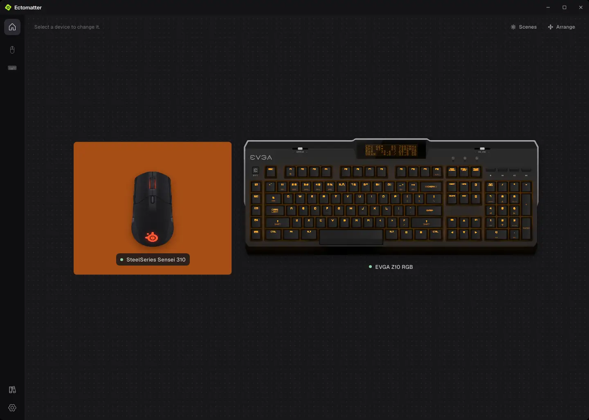
</p>

Keyboards, mice and the rest of a desk usually each come with their maker's
own app. Ectomatter is one app for all of them.

A device comes in as a **core**, a small package that knows how to talk to
it. The core describes its device (its picture, its keys, its lights and
effects, its screen, its settings), and Ectomatter does the rest: it draws the
device's pages, keeps its profiles and macros, plays it in scenes with
everything else on the desk, and switches it for each game. It's the only
peripheral app that draws your devices' lighting in high dynamic range on an
HDR monitor. **Plugins** bring
in what isn't a device: your games, your monitors, other programs, the
weather.

## Across all your devices

### Every device on one screen

Home draws every device to scale, lit as it's lit right now, and **Arrange**
puts each one where it sits on your real desk, on the pads and mats it sits
on, each a color of its own or a photo you choose. Keys and mouse buttons
send a ripple of their light across the desk as you press them. Select a
device to change it.

### One lighting scene across every device

A scene lights the whole desk at once. Play one effect across all of it, and
a wave crosses the keyboard, then the mouse, in the order they sit on Home; or
give each device an effect of its own.

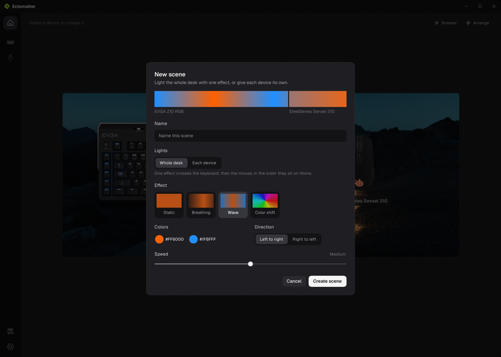

### Settings that switch with each game

The Library finds your Steam games and takes any you add by hand. For each
one, choose what changes while you play: the scene, the profile of every
device, how the game starts (its Proton build, gamescope, HDR, GameMode,
MangoHud) and how your monitors are set. The devices switch when the game
comes to the front and back when another app does, and when the game quits,
Ectomatter puts everything back.

<p>
  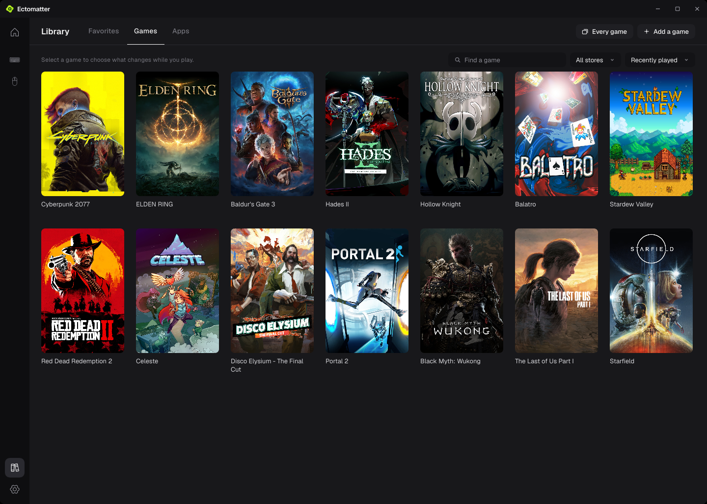
  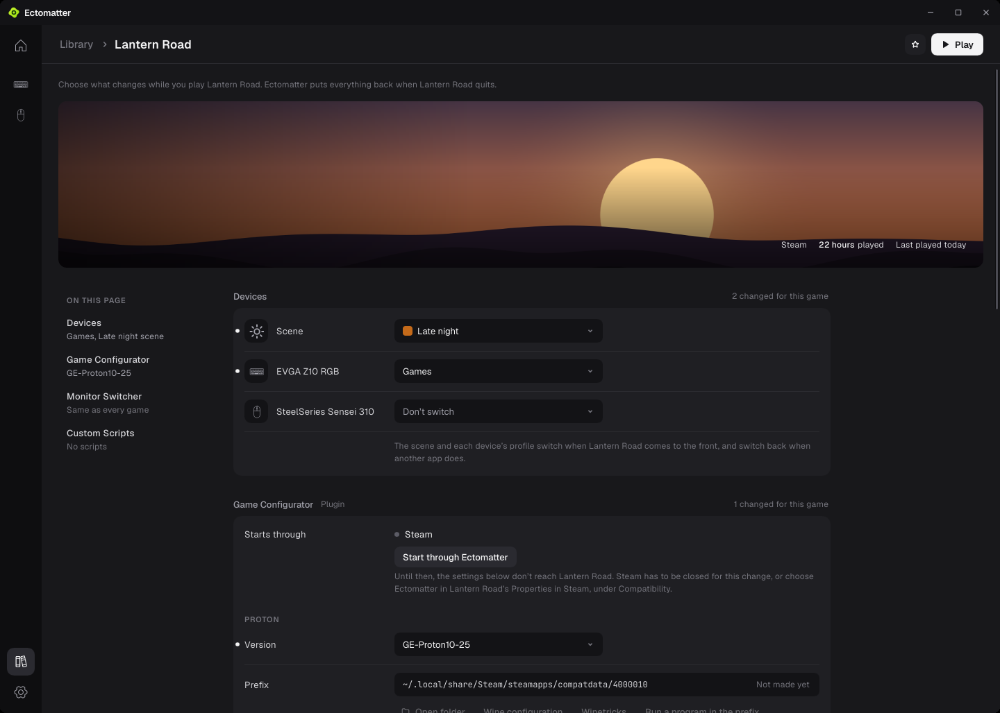
</p>

## For each device

Every device Ectomatter drives gets pages like these, built from what its
[core](#how-device-cores-work) describes. They're shown with the first two cores: an EVGA Z10 RGB
keyboard and a SteelSeries Sensei 310 mouse.

### Lighting effects

Every effect a device offers, each with its colors, brightness and speed,
across the whole device or the zones you pick, played on the device's own
picture as it plays on the device.

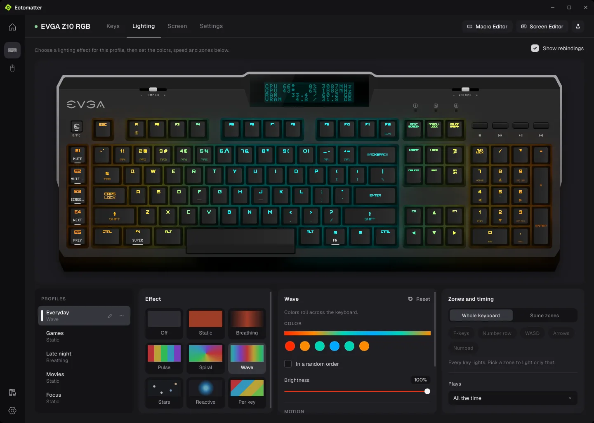

### Light simulated in HDR

Ectomatter works out each device's light as it really falls: up through each
switch and keycap, around each legend, into the wells between the keys,
through a mouse's diffusing logo. And it's the only peripheral app that draws
that light in high dynamic range: on an HDR monitor, a lit key glows brighter
than the white of the page, as a real LED does.

The **Keyboard Lab** and the **Mouse Lab** tune that light to match the device
on your desk: its keycaps and their plastic, its legends' typeface, size and
place, its LEDs, its wells, its screen, its windows. Each slider sets
something physical, in millimeters, lumens or a share of the light, and the
light follows it as you drag. Save the result as a setup of your own.

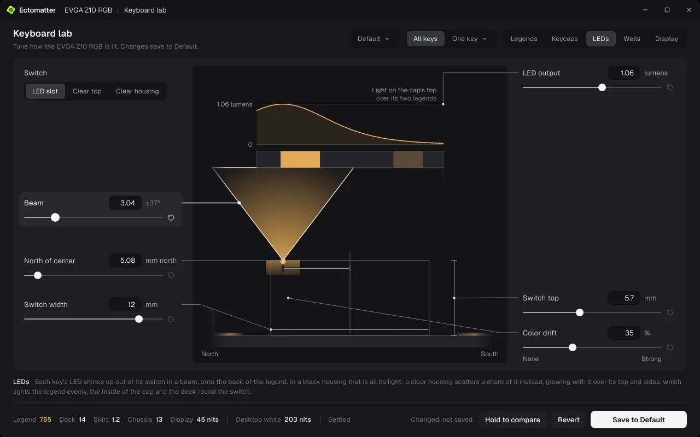

### Custom keycaps

Put your own caps on the keyboard, the ones you have or the ones you want:
shine-through, pudding or clear plastic, any color on their tops and sides,
legends in another typeface, weight, size and place, homing bumps on any
key. Mix them across the board, with an accent here and another color
there, and set any one key apart with words or a picture of its own in place
of its letter, like this owl. Caps the keyboard can't swap, like this one's
buttons and spacebar, stay as they are. Ectomatter lights each cap as its
plastic would.

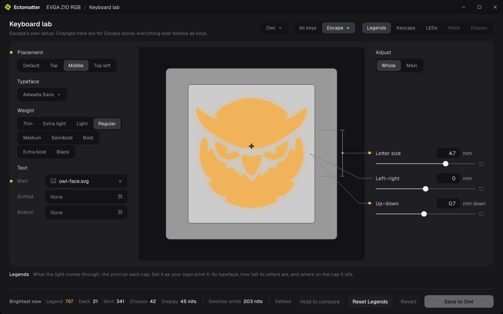


### Remap keys and buttons, record macros

Give any key or button another job: another key, media, a mouse button, a
macro, a profile, or nothing at all. The Macro Editor records what you type
and keeps each macro on the device when the device can hold it, or in
Ectomatter when it can't.

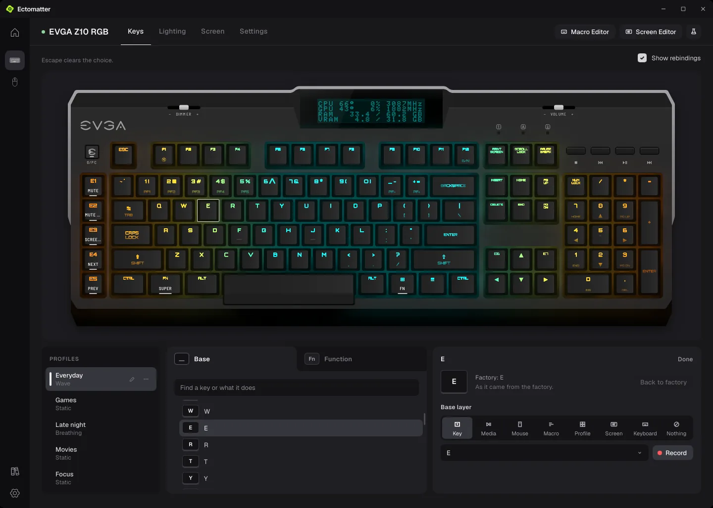

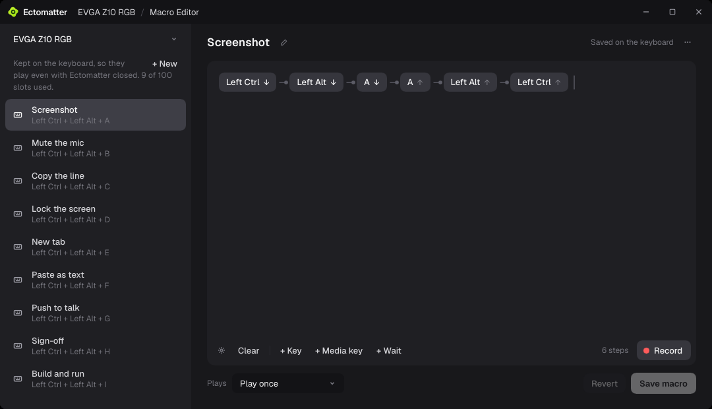

### Screens on your devices

A device with a screen gets a playlist of layouts: the computer's temperatures
and loads, the time, the weather where you are, a heartbeat that races as the
CPU works harder, rain, a starfield, a campfire, an aquarium. The Screen Editor
makes your own from text, readings, bars and effects, and the screen can show
a game starting and quitting.

<p>
  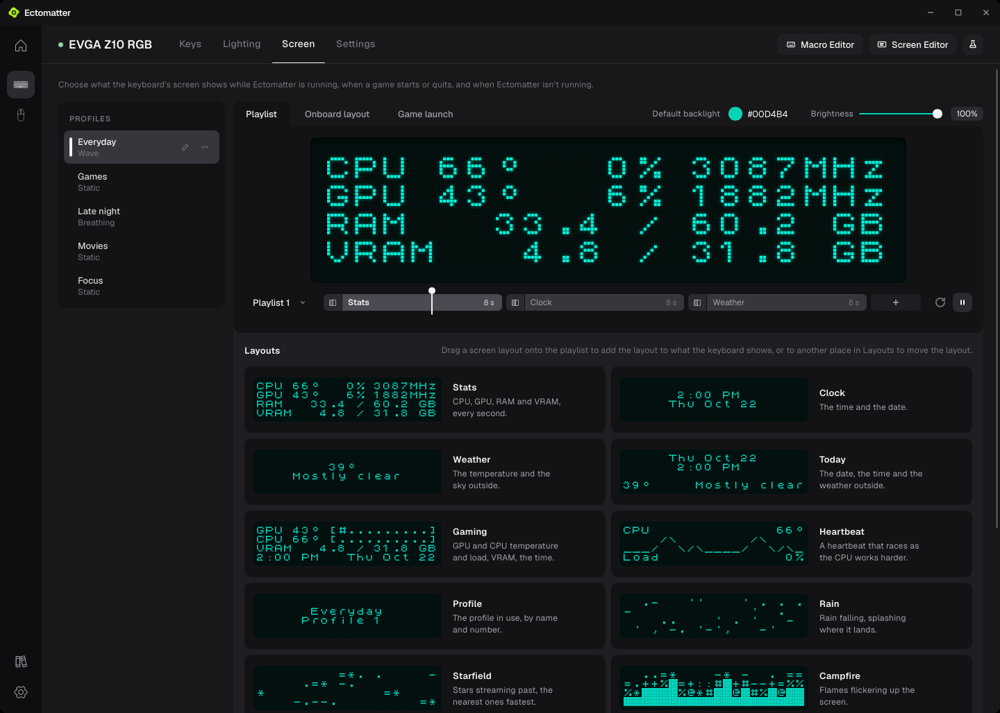
  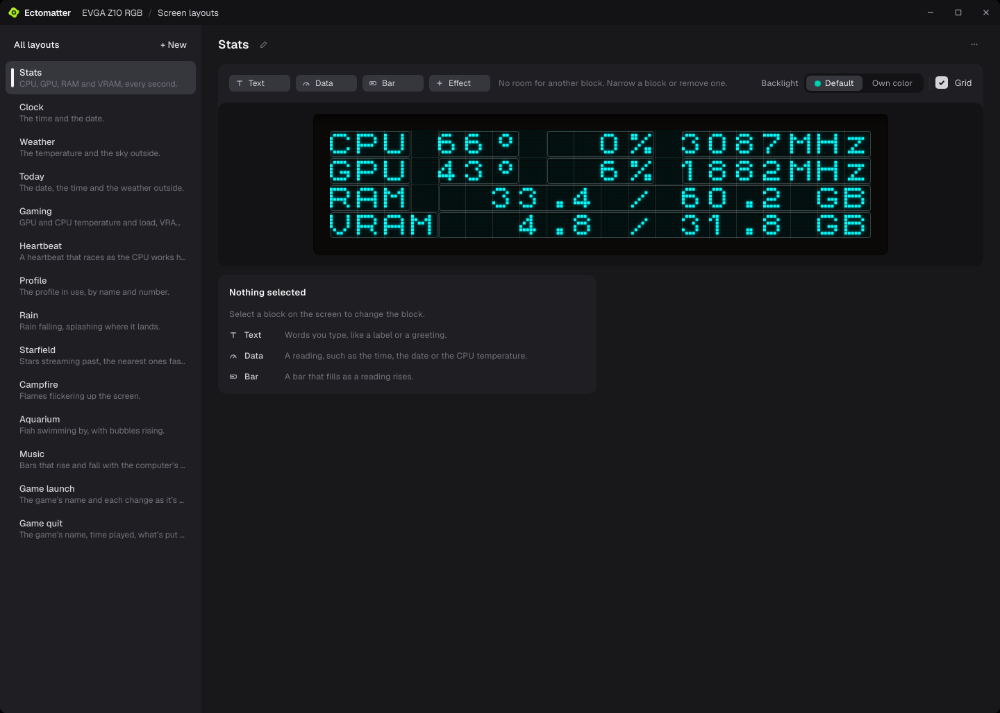
</p>

### Profiles and settings

Each device's settings on pages of their own, with profiles. A device that
keeps no profiles of its own, like this mouse, gets as many as you like, kept
by Ectomatter.

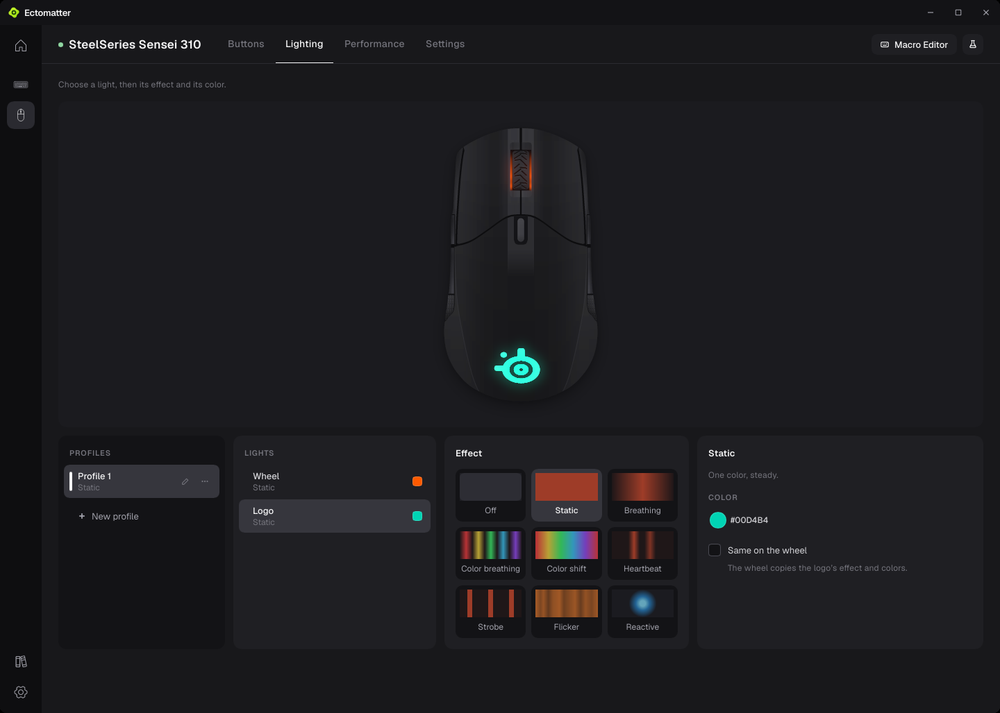

## How device cores work

Ectomatter works the way RetroArch does for emulators: one app, and a
**core** for each device. The core knows its device: how to find it, what it
can do and how to talk to it. Ectomatter does everything you see, and
everything that spans more than one device.

A core never draws a page. It describes its device in data:

- its drawing, one SVG in numbered pieces, so Ectomatter can find each key,
  button and screen on it
- its controls: every key, button, dial and slider, by name
- what's printed on each key, so the legends can be set again in another
  typeface, size or place
- its light: where each LED sits and how its light gets out, in millimeters
  and lumens, which Ectomatter simulates and the labs tune
- what it can do (its keys' jobs, macros, lighting effects, screens, profiles
  and settings), and only what the device really has

Ectomatter has one page for each thing a device can do, built from the
description, so every device that does it is set up the same way, whoever
made it. Nothing in the app is written for one device. Tests hold it to that:
a keyboard and a mouse it has never seen get their pages from their
descriptions alone, and no package is named anywhere in the app's own code.

How a core treats its device:

- **The device is the truth.** A device that keeps its settings in its own
  memory, as the keyboard does, is read each time, so there's no second copy
  to drift out of step. For a device that can't tell back what it's set to,
  as the mouse can't, Ectomatter keeps the record.
- **Changes are careful.** A preview plays on the device without storing
  anything. A save to the keyboard is read back to check it took, and before
  its first write each time it starts, the keyboard's core keeps a copy of
  every profile and macro on it. A command that could harm a device is never
  offered: the keyboard's core has no way into its firmware updater.
- **Each core is sealed off.** It runs inside Ectomatter as a WebAssembly
  module, on a thread of its own, and reaches only the USB devices its
  manifest lists. One that crashes, hangs or takes too much memory is stopped
  and started again, and nothing else goes down with it.

Is your device missing? Anyone can write its core:
[Making a core or a plugin](docs/making-a-package.md).

## Cores

| Core | Device | Keys and buttons | Lighting | Screen | Macros | Profiles |
|---|---|---|---|---|---|---|
| [EVGA Z10 RGB](https://github.com/Ectonomic/ectomatter-evga-z10) | Keyboard | 116 keys, each with a job on two layers | Every key, 8 effects, live in scenes | 20 by 4 characters, playing Ectomatter's layouts | 100, kept on the keyboard | 5, kept on the keyboard |
| [SteelSeries Sensei 310](https://github.com/Ectonomic/ectomatter-steelseries-sensei-310) | Mouse | 8 buttons | Logo and wheel, 8 effects each, live in scenes | None | Played by Ectomatter | As many as you like, kept by Ectomatter |

### EVGA Z10 RGB

A full-size keyboard with a small screen above the keys. Ectomatter reads and
writes everything the keyboard keeps: its five profiles, each key's job on
the base and Fn layers, its lighting (Static, Breathing, Pulse, Spiral, Wave,
Stars, Reactive and Per key), and up to 100 macros, which play even with
Ectomatter closed. It plays Ectomatter's layouts on the screen and lights
every key live in scenes. The keyboard's protocol was worked out from EVGA's
Unleash RGB 1.0.11.0 and, for the screen, from AIDA64. The firmware updater's
commands are left out on purpose.

### SteelSeries Sensei 310

An ambidextrous mouse with eight buttons, a lit logo and a lit wheel.
Ectomatter sets each button's job, each light's effect (Static, Breathing,
Color breathing, Color shift, Heartbeat, Strobe, Flicker and Reactive), its
two sensitivities and its polling rate. The mouse holds one set of these at a
time and can't tell all of them back, so Ectomatter keeps the profiles and
puts one on the mouse, and a button can play one of Ectomatter's macros. Its
commands were written with rivalcfg's profile of the mouse and libratbag's
SteelSeries driver as references.

## Plugins

A plugin brings in what isn't a device: your games, your monitors, other
programs, the weather. It's sealed off as a core is, and reaches only what
its manifest lists: the folders it reads, the programs it starts, the
addresses it talks to. A plugin can add a section to each game's page in the
Library, give screens readings to show, or bring another program's lights
into scenes.

| Plugin | What it does | Where it shows | What it reaches |
|---|---|---|---|
| [Game Configurator](https://github.com/Ectonomic/ectomatter-game-configurator) | Each game's Proton build, prefix, gamescope, GameMode and MangoHud, with backups of its prefix | Each game's page in the Library | The programs a game starts through (gamescope, GameMode, MangoHud), and Wine's configuration and Winetricks in a game's prefix |
| [Monitor Switcher](https://github.com/Ectonomic/ectomatter-monitor-switcher) | Each monitor's brightness, resolution, refresh rate, HDR and variable refresh while a game plays, which monitor is the main one, and which are off | Each game's page in the Library | Your monitors |
| [OpenRGB Link](https://github.com/Ectonomic/ectomatter-openrgb-link) | The lighting OpenRGB controls, such as your motherboard, RAM and LED strips, in scenes and switched for each game | Scenes, and each game's page in the Library | OpenRGB, running on this computer |
| [Sensor Feed](https://github.com/Ectonomic/ectomatter-sensor-feed) | Your computer's temperatures, loads, fans and memory | Readings for device screens | Your system's sensor files and NVIDIA's driver |
| [Weather Feed](https://github.com/Ectonomic/ectomatter-weather-feed) | The weather and its warnings where you are | Readings for device screens, and a section of Settings | Open-Meteo, Photon, the National Weather Service, Environment and Climate Change Canada, and MeteoAlarm |

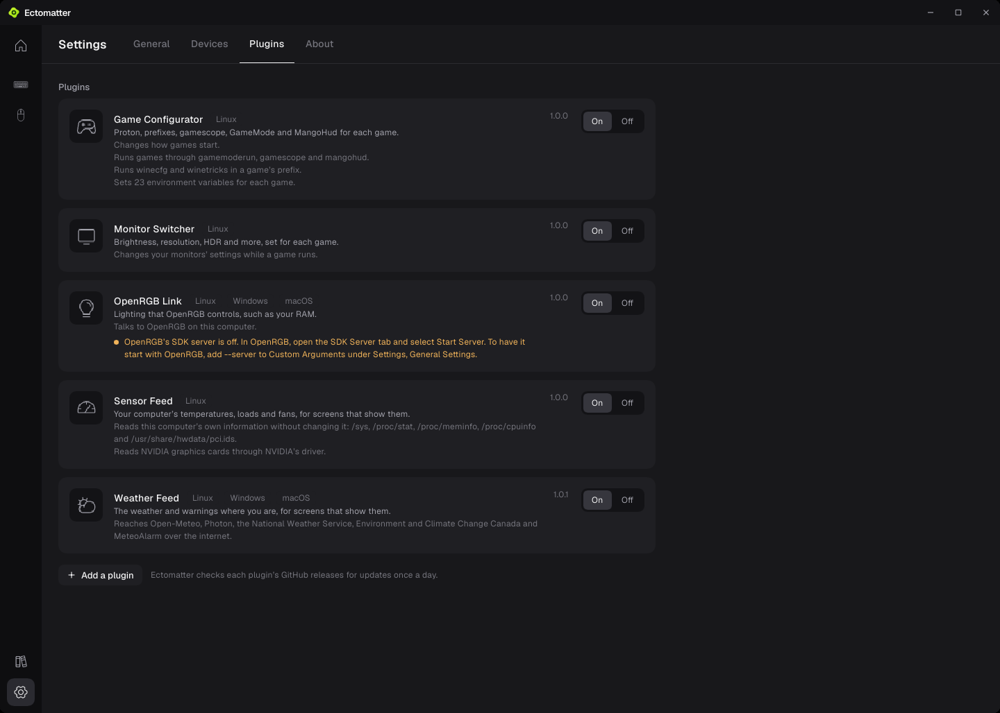

## Adding a core or a plugin

In Settings, **Add a device core** and **Add a plugin** show what a package
can reach before you add it, and take it only if it matches the checksum
pinned in [Ectonomic's list of reviewed packages](https://github.com/Ectonomic/ectomatter-packages).
Ectomatter checks each package's releases once a day, and a version that can
reach more than the one you have waits for you to review it. Each core and
plugin is a repository of its own, linked here under `cores/` and `plugins/`.

## Building and installing

Ectomatter runs on Linux, and is made and tested on KDE Plasma with Wayland.
Windows and macOS are planned. There's no release to download yet, so it's
built from source, with [Rust](https://rustup.rs):

```sh
git clone --recurse-submodules https://github.com/Ectonomic/Ectomatter
cd Ectomatter
rustup target add wasm32-wasip2
tools/build-cores.sh && tools/build-plugins.sh
cargo build --release -p ectomatter
```

On Linux, a program can open a USB device only where a udev rule lets it.
Ectomatter writes the rule for the devices its cores reach:

```sh
./target/release/ectomatter --udev-rules | sudo tee /etc/udev/rules.d/70-ectomatter.rules
sudo udevadm control --reload && sudo udevadm trigger
./target/release/ectomatter
```

Or make an RPM, which installs Ectomatter, its packages and the rule together:
`tools/package-rpm.sh`, then `sudo dnf install target/rpm/ectomatter-*.rpm`.

## How it's built and tested

Ectomatter is written in Rust and draws its windows with
[Slint](https://slint.dev). Its packages run as WebAssembly components in
[Wasmtime](https://wasmtime.dev). How the app and a package talk is in
[docs/core-protocol.md](docs/core-protocol.md) and [wit/core.wit](wit/core.wit).

What it promises is tested from the outside:

- **Boundaries.** Each boundary the app claims (what a package can reach, what
  it can't say about itself, what the app mustn't know about any one package)
  has a test that tries to cross it with a made-up package, a keyboard core
  Ectomatter has never seen among them. `tools/boundaries.sh` runs them all.
- **Pictures.** Every page is drawn offscreen in a sandbox, on a made-up desk,
  and held pixel for pixel to its approved picture. The pictures in this README
  are drawn the same way, and a change to a page they show fails until they're
  drawn again.
- **A stranger's computer.** The release build runs away from its source, with
  fresh settings and no devices, and installs as a Linux system lays a program
  out.

## License

Copyright (C) 2026 Ectonomic LLC. Made by Grant Garrison and Claude.

Ectomatter is free software under the GNU General Public License, version 3
only ([LICENSE](LICENSE)): you can share and change it under its terms. It
comes with no warranty. It draws its windows with Slint, which it takes under
the same license. The libraries it's built from and the files it carries from
others are under their own licenses, named in [REUSE.toml](REUSE.toml) with
their texts in [LICENSES/](LICENSES), and listed in the `NOTICES` the install
writes.

Ectomatter is an independent project, not made, endorsed or supported by EVGA,
SteelSeries or any other maker whose devices it drives.
