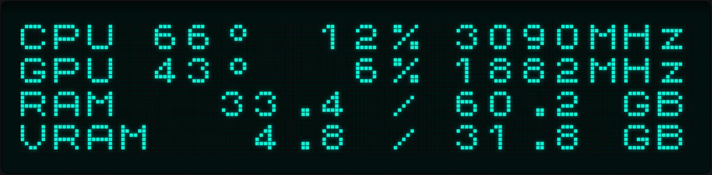
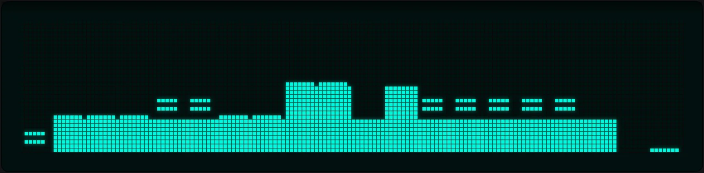

<p align="center">
  
</p>

<h1 align="center">Ectomatter</h1>

<p align="center">
  <strong>One app for every device on your desk.</strong><br>
  Your keyboard, mouse and the rest of your desk, set up in one place<br>
  and switched for each game you play.
</p>

<p align="center">
  <a href="#across-all-your-devices">Across all your devices</a> &nbsp;·&nbsp;
  <a href="#for-each-device">For each device</a> &nbsp;·&nbsp;
  <a href="#how-device-cores-work">How device cores work</a> &nbsp;·&nbsp;
  <a href="#cores">Cores</a> &nbsp;·&nbsp;
  <a href="#plugins">Plugins</a> &nbsp;·&nbsp;
  <a href="#building-and-installing">Building and installing</a>
</p>

<br>

<p align="center">
  
</p>

Keyboards, mice and the rest of a desk usually each come with their maker's
own app. Ectomatter is built to be one app for all of them.

Support for each device comes from a **core**: a small package that talks to
the device's hardware. The core describes the device: its picture, its keys
and buttons, its lights and effects, its screen and its settings. From that
description, Ectomatter builds the device's pages. The app also manages your
profiles and macros, plays lighting scenes across every device on the desk,
and switches each device's settings for each game. **Plugins** bring in
things that aren't devices: your games, your monitors, other programs and the
weather.

So far there are two cores, for the EVGA Z10 RGB keyboard and the SteelSeries
Sensei 310 mouse, and five plugins. Anyone can write a core for another
device.

Ectomatter is the only peripheral app that draws your devices' lighting in
high dynamic range on an HDR monitor.

## Across all your devices

### Every device on one screen

Home shows every device to scale, lit the way it's lit right now. **Arrange**
lets you place each device where it sits on your real desk, and add the pads
and mats under them, each in a color or a photo you choose. When you press a
key or a mouse button, a ripple of its light runs across the desk. Select a
device on Home to change its settings.

### One lighting scene across every device

A scene lights the whole desk at once. You can play one effect across
everything, so that a wave crosses the keyboard and then the mouse, in the
order the devices sit on Home. Or you can give each device an effect of its
own.


### Settings that switch with each game

The Library finds your Steam games, and you can add other games by hand. For
each game, choose what changes while you play: the lighting scene, the
profile of each device, how the game starts (its Proton build, gamescope,
HDR, GameMode and MangoHud) and how your monitors are set. Ectomatter switches
your devices when the game comes to the front, switches them back when
another app does, and puts everything back when the game quits.

<p>
  
  
</p>

## For each device

Each device that Ectomatter drives gets pages like the ones below, built
from the description in its [core](#how-device-cores-work). The pictures show
the first two cores: the EVGA Z10 RGB keyboard and the SteelSeries Sensei 310
mouse.

### Lighting effects

The Lighting page lists every effect the device offers. You set each
effect's colors, brightness and speed, and choose whether it covers the whole
device or only the zones you pick. The picture of the device plays the effect
just as the device does.


### Light simulated in HDR

Ectomatter simulates how light travels through each device, so the picture on
screen looks like the device on your desk. The light rises through each
switch and keycap, shines around each legend, fills the wells between the
keys, and spreads through a mouse's diffusing logo. On an HDR monitor,
Ectomatter draws this light in high dynamic range, so a lit key glows brighter
than the white of the page, the way a real LED does.

The **Keyboard Lab** and the **Mouse Lab** tune the simulation to match your
own device: the keycaps and their plastic, the typeface, size and position of
the legends, the LEDs, the wells between the keys, the screen, and the
mouse's light windows. Each slider sets a physical measurement, in
millimeters, lumens or a percentage of the light, and the light on screen
follows the slider as you drag it. You can save the result as a setup of your
own.


### Custom keycaps

The Keyboard Lab changes the keycaps in Ectomatter's picture of your keyboard,
to match the set you have on it or to try one you want. Choose shine-through,
pudding or clear plastic, any color for the tops and sides, a different
typeface, weight, size and position for the legends, and homing bumps on any
key. The caps can differ across the board, with an accent color on a few keys
and another color elsewhere. Any single key can have its own words, or a
picture in place of its letter, like the owl on the Escape key below. Caps
that can't be swapped on a keyboard, such as the Z10's buttons and spacebar,
keep their original look. Ectomatter lights each cap the way its plastic
would.


### Remap keys and buttons, record macros

You can give any key or button another job: a different key, a media key, a
mouse button, a macro, a profile switch, or nothing at all. The Macro Editor
records what you type. It saves each macro on the device if the device can
store macros, and in Ectomatter if the device can't.


### Screens on your devices

A device with a screen gets a playlist of layouts: the computer's temperatures
and loads, the time, the weather where you are, a heartbeat that races as the
CPU works harder, rain, a starfield, a campfire, an aquarium and bars that
rise and fall with the computer's sound. In the Screen Editor you can build
your own layouts from text, live readings, bars and effects. The screen can
also show when a game starts and quits.





<p>
  
  
</p>

### Profiles and settings

Each device has its settings on pages of its own, organized in profiles. A
device that stores no profiles itself, like this mouse, can have as many
profiles as you like, and Ectomatter stores them.


## How device cores work

Ectomatter follows the model RetroArch uses for emulators: one app, and a
**core** for each device. The core is responsible for the device: finding it,
knowing what it can do, and talking to it. Ectomatter is responsible for
everything you see, and for every feature that involves more than one device.

A core never draws any part of the interface. Instead, the core describes its
device as data:

- the device's drawing, a single SVG with numbered pieces, so that Ectomatter
  can find each key, button and screen in it
- the device's controls: every key, button, dial and slider, each with a name
- what's printed on each key, so that Ectomatter can set the legends again in
  another typeface, size or position
- the device's light: where each LED sits and how its light gets out of the
  device, measured in millimeters and lumens. Ectomatter simulates this
  light, and the labs tune it.
- what the device can do (key assignments, macros, lighting effects, screens,
  profiles and settings), listing only what the device really has

Ectomatter has one page for each thing a device can do, such as lighting or
key assignments, and builds each page from the description. So every device
that can do the same thing is set up the same way, whoever made it. The goal
is that nothing in the app is written for one particular device, and tests
check that goal: a keyboard and a mouse that Ectomatter has never seen get
their pages from their descriptions alone, and the app's own code must not
name any package. Some code is still written for the Z10 keyboard, such as
parts of its screen page, and for now Ectomatter drives one keyboard and one
mouse at a time. The [list of deferred work](docs/deferred.md) tracks each of
these gaps.

How a core treats its device:

- **The device holds the truth.** If a device keeps its settings in its own
  memory, as the Z10 keyboard does, the core reads the settings from the
  device every time, so there's never a second copy that can drift out of
  step. If a device can't report what it's set to, as the Sensei 310 mouse
  can't, Ectomatter keeps the record instead.
- **Changes are careful.** A preview plays on the device without saving
  anything. After a save, the Z10's core reads the profile back from the
  keyboard to confirm the save worked. Before its first write each time it
  starts, the Z10's core saves a copy of every profile and macro on the
  keyboard. The Z10's core also leaves out the commands of the keyboard's
  firmware updater, so the core can't start a firmware update.
- **Each core runs in isolation.** A core runs inside Ectomatter as a
  WebAssembly module on a thread of its own, and can reach only the USB
  devices its manifest lists. If a core crashes, hangs or uses too much
  memory, Ectomatter stops the core and starts it again, and nothing else is
  affected.

Is your device missing? Anyone can write a core for it:
[Making a core or a plugin](docs/making-a-package.md).

## Cores

| Core | Device | Keys and buttons | Lighting | Screen | Macros | Profiles |
|---|---|---|---|---|---|---|
| [EVGA Z10 RGB](https://github.com/Ectonomic/ectomatter-evga-z10) | Keyboard | 116 keys, each with a job on two layers | Every key, 8 effects, live in scenes | 20 by 4 characters, playing Ectomatter's layouts | 100, kept on the keyboard | 5, kept on the keyboard |
| [SteelSeries Sensei 310](https://github.com/Ectonomic/ectomatter-steelseries-sensei-310) | Mouse | 8 buttons | Logo and wheel, 8 effects each, live in scenes | None | Played by Ectomatter | As many as you like, kept by Ectomatter |

### EVGA Z10 RGB

A full-size keyboard with a small screen above the keys. Ectomatter reads and
writes everything the keyboard stores: five profiles, the job of each key on
the base layer and the Fn layer, the lighting (Static, Breathing, Pulse,
Spiral, Wave, Stars, Reactive and Per key), and up to 100 macros, which play
even when Ectomatter is closed. Ectomatter also plays its layouts on the
keyboard's screen and lights every key live in scenes. The keyboard's
protocol was worked out from EVGA's Unleash RGB 1.0.11.0 software and, for
the screen, from AIDA64. The commands for the keyboard's firmware updater are
left out on purpose.

### SteelSeries Sensei 310

An ambidextrous mouse with eight buttons, a lit logo and a lit scroll wheel.
Ectomatter sets each button's job, the effect on each light (Static,
Breathing, Color breathing, Color shift, Heartbeat, Strobe, Flicker and
Reactive), the mouse's two sensitivity levels and its polling rate. The mouse
holds only one set of these settings at a time and can't report all of them
back, so Ectomatter keeps the profiles and puts one on the mouse at a time. A
button can also play one of Ectomatter's macros. The core's commands were
written using rivalcfg's profile of this mouse and libratbag's SteelSeries
driver as references.

## Plugins

A plugin brings in something that isn't a device: your games, your monitors,
other programs or the weather. Like a core, a plugin runs in isolation and can
reach only what its manifest lists: the folders it reads, the programs it
starts and the network addresses it connects to. A plugin can add a section
to each game's page in the Library, provide readings for device screens to
show, or bring another program's lighting into scenes.

| Plugin | What it does | Where it shows | What it reaches |
|---|---|---|---|
| [Game Configurator](https://github.com/Ectonomic/ectomatter-game-configurator) | The Proton build, Wine prefix, gamescope, GameMode and MangoHud for each game, and backups of each game's prefix | Each game's page in the Library | The programs a game can start through (gamescope, GameMode, MangoHud), and Wine Configuration and Winetricks, run in a game's prefix |
| [Monitor Switcher](https://github.com/Ectonomic/ectomatter-monitor-switcher) | For each game: the brightness, resolution, refresh rate, HDR and variable refresh of each monitor, which monitor is the main one, and which monitors turn off | Each game's page in the Library | Your monitors |
| [OpenRGB Link](https://github.com/Ectonomic/ectomatter-openrgb-link) | The lighting OpenRGB controls, such as your motherboard, RAM and LED strips, in scenes and switched for each game | Scenes, and each game's page in the Library | OpenRGB, running on this computer |
| [Sensor Feed](https://github.com/Ectonomic/ectomatter-sensor-feed) | Your computer's temperatures, loads, fans and memory | Readings for device screens | Your system's sensor files and NVIDIA's driver |
| [Weather Feed](https://github.com/Ectonomic/ectomatter-weather-feed) | The weather and weather warnings for where you are | Readings for device screens, and its own section in Settings | Open-Meteo, Photon, the National Weather Service, Environment and Climate Change Canada, and MeteoAlarm |


## Adding a core or a plugin

In Settings, **Add a device core** and **Add a plugin** list the packages on
[Ectonomic's list of reviewed packages](https://github.com/Ectonomic/ectomatter-packages)
and show what each package can reach before you add it. A package from the
list must match the checksum the list pins for it, so Ectomatter refuses a
release that was changed after Ectonomic reviewed it.

You can also add a package that isn't on the list, from its GitHub address or
its file, with **From an address or a file…**. Nobody at Ectonomic has
reviewed a package added this way, and the form says so. As with a listed
package, Ectomatter shows what the package can reach before you add it, so you
can decide for yourself.

Once a day, Ectomatter looks for a new version of each package: the newest
version on the list for a listed package, or the newest release in the
package's GitHub repository for any other. If a new version can reach more
than the version you have, the new version waits until you review it. Each
core and each plugin has a repository of its own, linked into this repository
under `cores/` and `plugins/`.

## Building and installing

Ectomatter runs on Linux. It's made and tested on KDE Plasma with Wayland;
Windows and macOS are planned. There's no release to download yet, so build
Ectomatter from source with [Rust](https://rustup.rs):

```sh
git clone --recurse-submodules https://github.com/Ectonomic/Ectomatter
cd Ectomatter
rustup target add wasm32-wasip2
tools/build-cores.sh && tools/build-plugins.sh
cargo build --release -p ectomatter
```

On Linux, a program can open a USB device only if a udev rule allows it.
Ectomatter can write that rule for the devices its cores use:

```sh
./target/release/ectomatter --udev-rules | sudo tee /etc/udev/rules.d/70-ectomatter.rules
sudo udevadm control --reload && sudo udevadm trigger
./target/release/ectomatter
```

You can also build an RPM, which installs Ectomatter, its cores and plugins,
and the udev rule together: run `tools/package-rpm.sh`, then
`sudo dnf install target/rpm/ectomatter-*.rpm`.

## How it's built and tested

Ectomatter is written in Rust and draws its windows with
[Slint](https://slint.dev). Cores and plugins run as WebAssembly components in
[Wasmtime](https://wasmtime.dev). The protocol between Ectomatter and its
packages is documented in [docs/core-protocol.md](docs/core-protocol.md) and
[wit/core.wit](wit/core.wit).

Ectomatter's promises are tested from the outside:

- **Boundaries.** For each boundary Ectomatter claims, such as what a package
  can reach, what a package can't say about itself, and what the app must not
  know about any single package, a test tries to cross the boundary with a
  made-up package. One of those made-up packages is a keyboard core that
  Ectomatter has never seen. `tools/boundaries.sh` runs all of these tests.
- **Pictures.** Every page is drawn offscreen in a sandbox, on a made-up desk,
  and compared pixel for pixel with its approved picture. The still pictures
  in this README are drawn and checked the same way, so a change to a page
  they show makes the test fail until the pictures are drawn again.
- **A fresh computer.** The release build runs outside its source folder,
  with fresh settings and no devices, and installs the way a Linux system
  lays out a program.

## License

Copyright (C) 2026 Ectonomic LLC. Made by Grant Garrison and Claude.

Ectomatter is free software under the GNU General Public License, version 3
only ([LICENSE](LICENSE)): you can share and change it under the license's
terms. It comes with no warranty. Ectomatter draws its windows with Slint,
used under the same license. The libraries the app is built from, and the
files it includes from others, are under their own licenses:
[REUSE.toml](REUSE.toml) names them, [LICENSES/](LICENSES) holds their texts,
and the `NOTICES` file written at install lists them.

Ectomatter is an independent project. It isn't made, endorsed or supported by
EVGA, SteelSeries or any other maker of the devices it drives.
