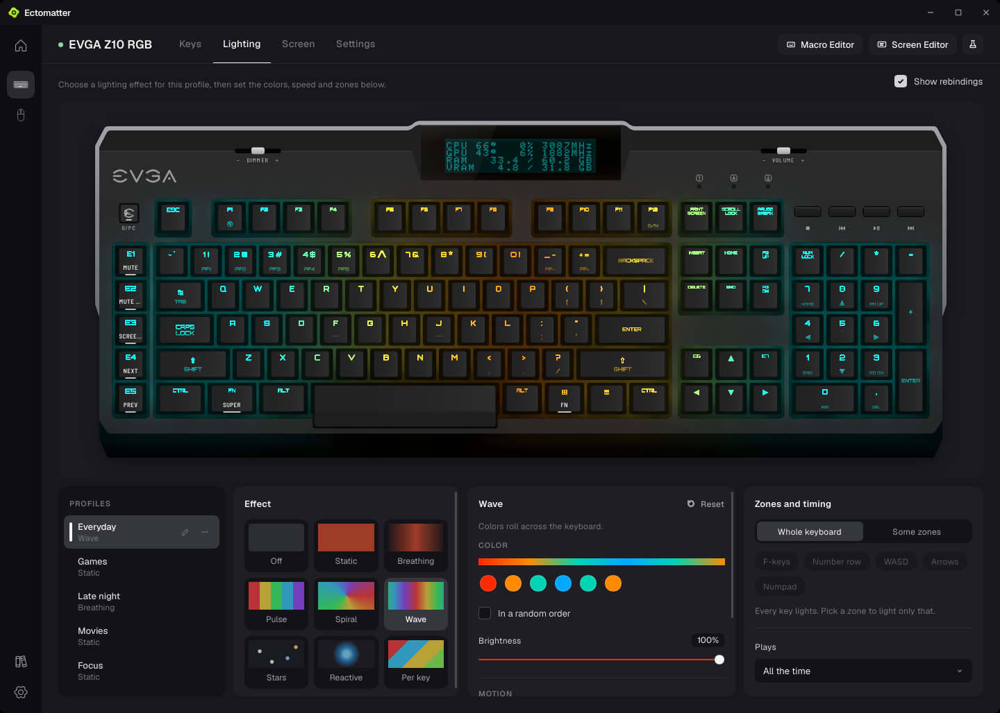
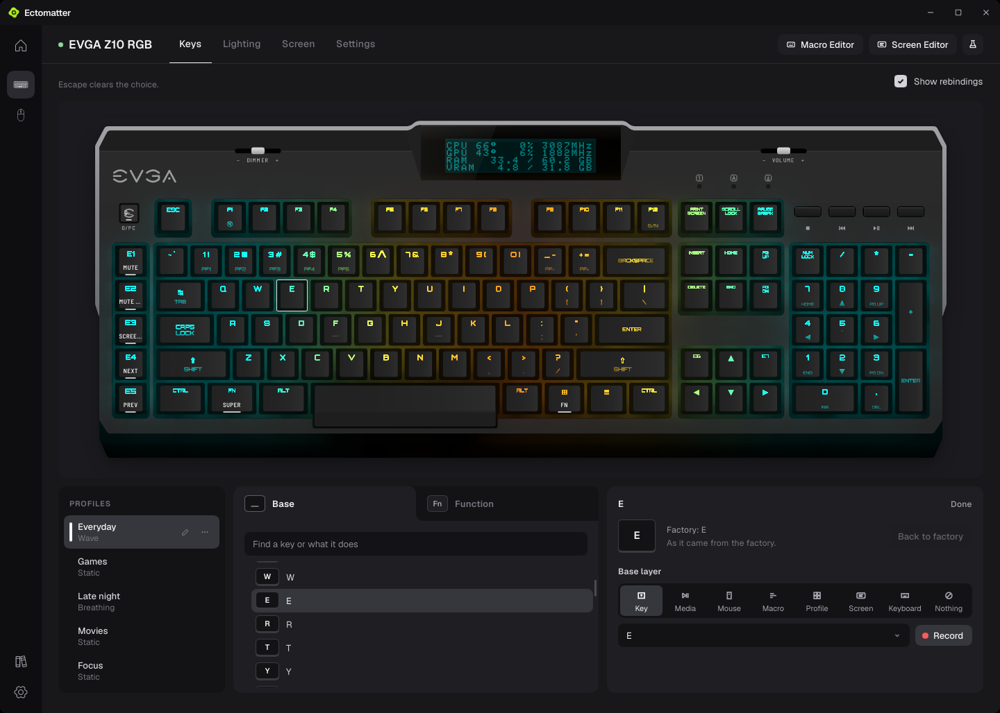

<p align="center">
  
</p>

<h1 align="center">Ectomatter</h1>

<p align="center">
  <strong>One app for every device on your desk.</strong><br>
  Keys, lights, screens and settings for whatever you plug in, whoever made it,<br>
  and a desk that changes with the game you're playing.
</p>

<p align="center">
  <a href="#the-desk">The desk</a> &nbsp;·&nbsp;
  <a href="#what-a-device-gets">What a device gets</a> &nbsp;·&nbsp;
  <a href="#cores-and-plugins">Cores and plugins</a> &nbsp;·&nbsp;
  <a href="#getting-it">Getting it</a>
</p>

<br>

<p align="center">
  
</p>

Keyboards, mice and the rest of a desk usually each come with their maker's
own app. Ectomatter is one app for all of them.

A device comes in as a **core**, a small package that knows how to talk to
it. The core describes its device (its picture, its keys, its lights and
effects, its screen, its settings), and Ectomatter does the rest: it draws the
device's pages, keeps its profiles and macros, plays it in scenes with
everything else on the desk, and switches it for each game. **Plugins** bring
in what isn't a device: your games, your monitors, other programs, the
weather.

## The desk

### Everything you have, in one place

Home draws every device to scale, lit as it's lit right now, and **Arrange**
puts each one where it sits on your real desk, on a mat if it sits on one.
Select a device to change it.

### Scenes across every device

A scene lights the whole desk at once. Play one effect across all of it, and
a wave crosses the keyboard, then the mouse, in the order they sit on Home; or
give each device an effect of its own.


### A desk for every game

The Library finds your Steam games and takes any you add by hand. For each
one, choose what changes while you play: the scene, the profile of every
device, how the game starts (its Proton build, gamescope, HDR, GameMode,
MangoHud) and how your monitors are set. The devices switch when the game
comes to the front and back when another app does, and when the game quits,
Ectomatter puts everything back.

<p>
  
  
</p>

## What a device gets

Every device Ectomatter drives gets pages like these, built from what its
core describes. They're shown with the first two cores: an EVGA Z10 RGB
keyboard and a SteelSeries Sensei 310 mouse.

### Lighting

Every effect a device offers, each with its colors, brightness and speed,
across the whole device or the zones you pick, played on the device's own
picture as it plays on the device.



### Keys, buttons and macros

Give any key or button another job: another key, media, a mouse button, a
macro, a profile, or nothing at all. The Macro Editor records what you type
and keeps each macro on the device when the device can hold it, or in
Ectomatter when it can't.




### Screens

A device with a screen gets a playlist of layouts: the computer's temperatures
and loads, the time, the weather where you are, a heartbeat that races as the
CPU works harder, rain, a starfield, a campfire, an aquarium. The Screen Editor
makes your own from text, readings, bars and effects, and the screen can show
a game starting and quitting.

<p>
  
  
</p>

### Profiles and settings

Each device's settings on pages of their own, with profiles. A device that
keeps no profiles of its own, like this mouse, gets as many as you like, kept
by Ectomatter.


## Cores and plugins

Every core and plugin runs inside Ectomatter as a WebAssembly module and
reaches only what its manifest names: a core, the USB devices it lists; a
plugin, the folders, programs and addresses it lists. In Settings, **Add a
device core** and **Add a plugin** show what a package can reach before you
add it, and take it only if it matches the checksum pinned in
[Ectonomic's list of reviewed packages](https://github.com/Ectonomic/ectomatter-packages).
Ectomatter checks each package's releases once a day, and a version that can
reach more than the one you have waits for you to review it.

These are the packages so far, each in a repository of its own, linked here
under `cores/` and `plugins/`:

| | Package | What it does |
|---|---|---|
| Core | [EVGA Z10 RGB](https://github.com/Ectonomic/ectomatter-evga-z10) | Keys, lighting and the screen of the EVGA Z10 RGB |
| Core | [SteelSeries Sensei 310](https://github.com/Ectonomic/ectomatter-steelseries-sensei-310) | Buttons, lighting and sensitivity of the SteelSeries Sensei 310 |
| Plugin | [Game Configurator](https://github.com/Ectonomic/ectomatter-game-configurator) | Proton, prefixes, gamescope, GameMode and MangoHud for each game |
| Plugin | [Monitor Switcher](https://github.com/Ectonomic/ectomatter-monitor-switcher) | Brightness, resolution, HDR and more, set for each game |
| Plugin | [OpenRGB Link](https://github.com/Ectonomic/ectomatter-openrgb-link) | Lighting that OpenRGB controls, such as your RAM, in scenes and switched for each game |
| Plugin | [Sensor Feed](https://github.com/Ectonomic/ectomatter-sensor-feed) | Your computer's temperatures, loads and fans, for screens that show them |
| Plugin | [Weather Feed](https://github.com/Ectonomic/ectomatter-weather-feed) | The weather and warnings where you are, for screens that show them |


Is your device missing? A core is how it gets here, and anyone can write one:
[Making a core or a plugin](docs/making-a-package.md).

## Getting it

Ectomatter runs on Linux, and is made and tested on KDE Plasma with Wayland.
Windows and macOS are planned. There's no release to download yet, so it's
built from source, with [Rust](https://rustup.rs):

```sh
git clone --recurse-submodules https://github.com/Ectonomic/Ectomatter
cd Ectomatter
rustup target add wasm32-wasip2
tools/build-cores.sh && tools/build-plugins.sh
cargo build --release -p ectomatter
```

On Linux, a program can open a USB device only where a udev rule lets it.
Ectomatter writes the rule for the devices its cores reach:

```sh
./target/release/ectomatter --udev-rules | sudo tee /etc/udev/rules.d/70-ectomatter.rules
sudo udevadm control --reload && sudo udevadm trigger
./target/release/ectomatter
```

Or make an RPM, which installs Ectomatter, its packages and the rule together:
`tools/package-rpm.sh`, then `sudo dnf install target/rpm/ectomatter-*.rpm`.

## How it's built

Ectomatter is written in Rust and draws its windows with
[Slint](https://slint.dev). Its packages run as WebAssembly components in
[Wasmtime](https://wasmtime.dev). How the app and a package talk is in
[docs/core-protocol.md](docs/core-protocol.md) and [wit/core.wit](wit/core.wit).

What it promises is tested from the outside:

- **Boundaries.** Each boundary the app claims (what a package can reach, what
  it can't say about itself, what the app mustn't know about any one package)
  has a test that tries to cross it with a made-up package, a keyboard core
  Ectomatter has never seen among them. `tools/boundaries.sh` runs them all.
- **Pictures.** Every page is drawn offscreen in a sandbox, on a made-up desk,
  and held pixel for pixel to its approved picture. The pictures in this README
  are drawn the same way, and a change to a page they show fails until they're
  drawn again.
- **A stranger's computer.** The release build runs away from its source, with
  fresh settings and no devices, and installs as a Linux system lays a program
  out.

## License

Copyright (C) 2026 Ectonomic LLC. Made by Grant Garrison and Claude.

Ectomatter is free software under the GNU General Public License, version 3
only ([LICENSE](LICENSE)): you can share and change it under its terms. It
comes with no warranty. It draws its windows with Slint, which it takes under
the same license. The libraries it's built from and the files it carries from
others are under their own licenses, named in [REUSE.toml](REUSE.toml) with
their texts in [LICENSES/](LICENSES), and listed in the `NOTICES` the install
writes.

Ectomatter is an independent project, not made, endorsed or supported by EVGA,
SteelSeries or any other maker whose devices it drives.
